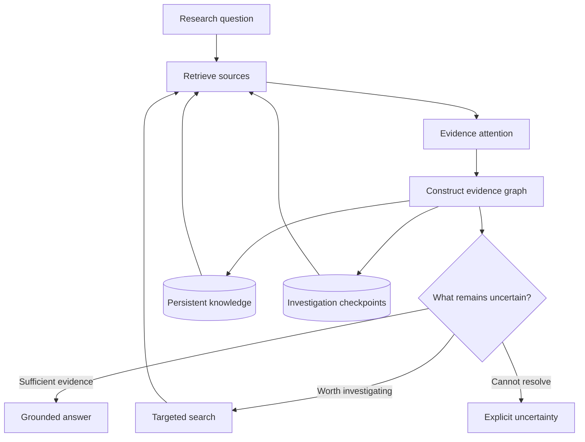
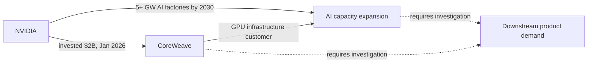
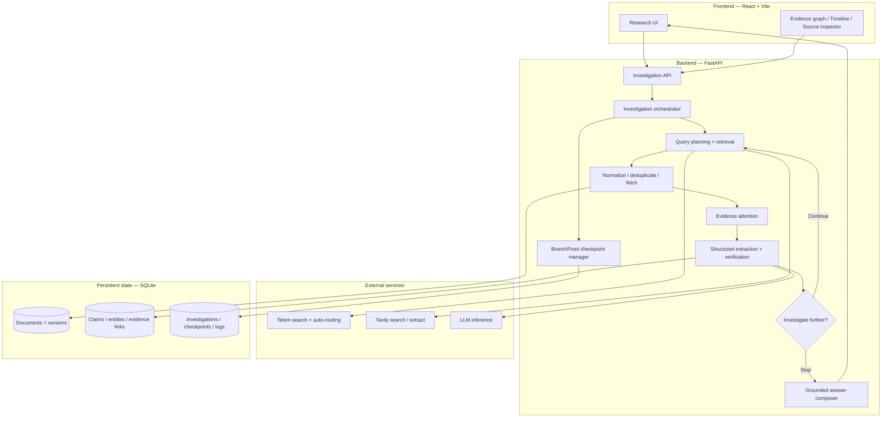

# FrontierGraph — SearchHack Product & Technical Specification

**November 14, 2026 · Product Decomposition · Hackathon MVP**

**Product thesis:** What if AI search didn't just retrieve information, but investigated relationships, challenged its own findings, and remembered what it learned?

**FrontierGraph** is a persistent, evidence-aware research engine that discovers and verifies relationships across sources and disciplines. It decides what information matters, what questions remain unresolved, and whether further searching is worth the cost.

The original **BranchPoint** concept becomes its investigation checkpointing and memory subsystem.

## 1. High-level idea



Conceptual loop: search produces evidence, evidence produces questions, and questions determine the next search. Knowledge and investigation state persist between sessions.

A conventional search engine primarily answers: *What information matches this query?*

FrontierGraph addresses four additional questions:

**What matters?** Rank passages by relevance, provenance, and relationships to the research question.

**What connects?** Discover relationships between claims, entities, sources, and disciplines.

**What next?** Select targeted investigations, challenge assumptions, or stop when evidence is sufficient.

**What do we remember?** Preserve established findings, unresolved questions, source history, and investigation checkpoints.

### Recommended first market

**Technology and investment intelligence.** Analysts and investors need to identify hidden technical dependencies, supply-chain relationships, market exposure, and emerging technologies. Missing one relationship can be more expensive than the cost of conducting another search.

Longer-term applications include R&D intelligence, investigative journalism, policy analysis, and personalized research.

## 2. Novelty

The strongest defensible innovation is not a new search API, language model, knowledge graph, or multi-agent framework.

It is the **coordination of retrieval, provenance, persistent relationships, and investigation decisions under a limited search budget**.

> **Proposed technical novelty: budget-aware, provenance-conditioned investigation over a persistent evidence graph.** The system uses what it knows, why it believes it, and what remains uncertain to choose its next search action.

| Mechanism    | Conventional approach                        | FrontierGraph's proposed distinction                               |
| ------------ | -------------------------------------------- | ------------------------------------------------------------------ |
| Retrieval    | Retrieve relevant pages                      | Prioritize evidence using query context and graph state            |
| Synthesis    | Summarize documents                          | Construct explicitly supported relationships                       |
| Verification | Provide citations                            | Trace support, contradiction, and source lineage                   |
| Exploration  | Follow predetermined steps or agent judgment | Select investigations using expected value and cost                |
| Memory       | Save answers or chat history                 | Preserve evidence, dependencies, unresolved gaps, and stop reasons |
| Updating     | Refresh a full result                        | Revalidate only findings affected by changed evidence              |

The difference between *interesting design* and *demonstrated innovation* is measurement. Prove at least one of the following against a standard retrieval-augmented generation (RAG) baseline: better relationship correctness, improved detection of unsupported claims, fewer redundant searches, or more useful findings within the same budget.

**Novelty boundary:** Graph-based RAG, temporal knowledge graphs, agentic research, checkpointing, and source attribution all have prior art. Do not claim to have invented those components. The combination and the tested investigation-selection mechanism are your contribution.

## 3. What technology we are building atop

There are three layers to distinguish: **existing retrieval infrastructure**, **existing research and agent frameworks**, and **the capabilities FrontierGraph actually contributes**.

| Technology         | Existing capability                                                           | Our use                                |
| ------------------ | ----------------------------------------------------------------------------- | -------------------------------------- |
| Telem AI           | Multi-provider search, auto-routing, page fetching, monitoring, search traces | Primary retrieval infrastructure       |
| Tavily             | Search, web extraction, relevance metadata                                    | Complementary retrieval and extraction |
| LangGraph          | Agent workflows, state and checkpoints                                        | Optional orchestration framework       |
| Microsoft GraphRAG | Entity and relationship extraction, graph-based context                       | Prior art and algorithmic reference    |
| Graphiti           | Temporal relationships, incremental graph updates                             | Reference for future persistent memory |
| React Flow         | Interactive node-edge visualization                                           | Evidence graph frontend                |

Telem explicitly supports auto-routing and normalized search results, while Tavily supports targeted extraction of selected pages. Microsoft GraphRAG already models entities, claims, and relationships, and Graphiti already handles evolving temporal graphs.

### What is ours versus theirs?

**FrontierGraph — our application layer**

- Evidence attention
- Evidence verification
- Investigation planning
- Knowledge / checkpoint policy

**Existing frameworks & infrastructure**

- Telem + Tavily
- LLM / structured extraction
- SQLite / LangGraph
- React + graph renderer

The product's value is not merely exposing Telem through a prettier interface. FrontierGraph needs to produce additional investigative decisions and durable evidence structures that the underlying search provider does not produce.

## 4. What technology we are using as a baseline

Use a controlled RAG baseline rather than claiming you outperform Perplexity without comparable measurements.

| Configuration              | Architecture                              | Purpose                                                   |
| -------------------------- | ----------------------------------------- | --------------------------------------------------------- |
| **B0: Standard RAG**       | Search → relevant chunks → LLM answer     | Establish ordinary search quality                         |
| **B1: Evidence-aware RAG** | B0 + evidence ranking and verification    | Is source-aware attention useful?                         |
| **B2: Graph RAG**          | B0 + extracted claim/entity relationships | Does graph structure add value?                           |
| **B3: FrontierGraph**      | Evidence graph + planner + checkpoints    | Does iterative, remembered investigation improve results? |

For a hackathon, **implement B0 and B3 first**. Add B1 as an ablation only if the main application works. You can explain B2 theoretically rather than spending your remaining time implementing four separate pipelines.

For a fair evaluation, keep the model, initial query, and access to sources constant. Give each configuration the same maximum search budget. Record actual tool calls, retrieved documents, supported relationships, and errors.

External comparisons:

- Perplexity: benchmark the cited-answer experience.
- Brave Search and Bright Data: infrastructure and retrieval alternatives.
- Microsoft GraphRAG: conceptual graph-retrieval baseline.

## 5. Story behind the product and its features

The product needs one cohesive narrative rather than nine disconnected features.

### The originating problem: search doesn't maintain an investigation

Consider how a technology analyst researches the AI semiconductor ecosystem.

They search for NVIDIA, find investments, discover GPU cloud providers, encounter power infrastructure, then realize advanced semiconductor packaging depends on unfamiliar manufacturing technologies.

The meaningful finding may be several relationships away from the original query.

Ordinary search may retrieve all the necessary information, but the researcher still has to determine which relationships matter, verify claims, preserve context, and decide when to stop.

That creates this product narrative:

- **Chapter 1 — Too much information.** We introduce evidence attention to prioritize passages and research-relevant claims instead of simply presenting additional pages.
- **Chapter 2 — Important connections are fragmented.** We construct an evidence graph connecting entities, claims, supporting passages, and competing explanations.
- **Chapter 3 — Repetition isn't verification.** We inspect source origins, recognize duplicated reporting, and distinguish supported facts from interpretations and hypotheses.
- **Chapter 4 — Research doesn't have a predetermined depth.** We introduce a bounded investigation loop that identifies gaps and decides whether an additional search has enough expected value.
- **Chapter 5 — Research shouldn't restart from zero.** BranchPoint saves the established graph, unresolved questions, and the decisions that led to stopping or continuing.
- **Chapter 6 — Knowledge changes.** Eventually, selective monitoring and source-version dependencies let the system recheck affected conclusions without restarting the investigation.

### How features support the story

| Feature                   | User-visible result                              | Hackathon priority |
| ------------------------- | ------------------------------------------------ | ------------------ |
| Source-aware attention    | Ranked evidence passages                         | P0                 |
| Evidence graph            | Clickable relationships                          | P0                 |
| Provenance verification   | Support, conflict, and origin labels             | P0                 |
| Adaptive investigation    | One targeted follow-up with a recorded reason    | P0                 |
| BranchPoint checkpoint    | Resume a related query without starting over     | P0                 |
| Passage highlighting      | Exact cited text when available                  | P1                 |
| Cross-domain discovery    | Find an unfamiliar but relevant technical bridge | P1                 |
| Domain-specialist routing | Different evidence policies by discipline        | P2                 |
| Continuous monitoring     | Automatically incorporate source changes         | P2                 |

P0 = necessary for the core demo; P1 = build if time permits; P2 = post-hackathon or stretch scope.

A useful conceptual inspiration is transformer attention: important evidence influences context selection. However, the MVP should use an externally computed, source-aware relevance function, **not claim to implement novel neural attention or causal attribution at the token level**. Span highlighting can show which textual evidence supports a claim without falsely claiming to explain the internal workings of the LLM.

## 6. Stories, example investigations, success criteria, and demos

Establish four test stories, but implement only two as the core live demonstration.

### Story A — The NVIDIA infrastructure ecosystem

*Primary real-world demo · relationship discovery*

**Question:** How do NVIDIA's investments, GPU infrastructure customers, and AI capacity expansion reinforce one another?

In January 2026, NVIDIA announced a $2 billion investment in CoreWeave and an expanded collaboration associated with a target of more than 5 GW of AI factories by 2030.

**Expected behavior:** Extract the documented investment and infrastructure relationships, then investigate a missing financial or demand-side connection without presenting the proposed causal explanation as fact.

### Story B — Hidden connections between AI and ceramics

*Cross-domain discovery*

**Question:** What non-obvious materials technologies could matter to advanced AI semiconductors?

Kyocera announced a multilayer ceramic-core substrate in April 2026, emphasizing rigidity, reduced package warpage, and higher-density wiring for advanced chips.

**Expected behavior:** Discover a materials-science connection to computing infrastructure and explain the physical engineering mechanism behind it.

This is a verifiable substitute for the currently unsubstantiated ceramics/toilet-company stock-market anecdote.

### Story C — Three articles, one original source

*Primary controlled demo · verification*

**Question:** Do three articles independently substantiate a company's claim?

Construct three synthetic articles that reference the same fictional company announcement. Give them different framing and introduce one deliberate factual discrepancy.

**Expected behavior:** Recognize their shared origin, isolate the conflicting passage, and distinguish one underlying account from three independent confirmations.

### Story D — Did release timing hurt Titanfall 2?

*Stretch demo · causal uncertainty*

**Question:** How much evidence supports the belief that release timing harmed Titanfall 2's commercial performance?

The game launched October 28, 2016, between Battlefield 1 and Call of Duty: Infinite Warfare. Contemporary reporting discusses analysts' predictions and EA's response.

**Expected behavior:** Separate observed release timing from the hypothesis of causally reduced sales. The system should not mistake a plausible narrative for established causation.

### Example of the graph in Story A



- Solid edges: documented relationships.
- Dashed edges: requires investigation.

Illustrative relationship graph, not an automatically verified output. Each factual edge in the actual product must link to a source passage.

A judge should be able to click the investment edge, inspect the January 2026 NVIDIA announcement, then select an unresolved question to see the system initiate another search.

### Success criteria

Define measurable criteria **before the demo**. These are proposed targets, not achieved results.

| Capability              | MVP acceptance criterion                                                                         |
| ----------------------- | ------------------------------------------------------------------------------------------------ |
| Retrieval               | Complete a live Telem search and retrieve usable page content                                    |
| Provenance              | 100% of displayed verified edges have inspectable source references                              |
| Citation integrity      | Quoted evidence spans exist in the stored source version                                         |
| Relationship discovery  | Extract at least three correct, supported relationships in the selected real-world investigation |
| Source independence     | Identify the common origin of all three controlled articles                                      |
| Contradiction detection | Detect the deliberately conflicting claim in Story C                                             |
| Agentic search          | Generate and execute at least one justified follow-up query                                      |
| Stopping behavior       | Stop on evidence sufficiency, unresolved uncertainty, or budget exhaustion                       |
| Memory                  | Reload an investigation and reuse stored evidence without repeating unchanged fetches            |
| Baseline                | Compare at least one outcome and resource cost against B0                                        |

For outcome metrics, prioritize **supported relationship precision**, **citation correctness**, **contradiction detection**, and **cost per supported finding**.

Avoid an arbitrary 90% accuracy claim from a handful of examples. Show small-sample counts transparently, such as four correctly supported relationships out of five predicted, with manual ground-truth labels.

### The three-minute live demo

1. **0:00–0:25 — Explain the problem.** Show conventional cited search versus an evidence investigation. State that the missing capability is persistent, verified relationship discovery.
2. **0:25–1:15 — Run NVIDIA investigation.** Enter the question, show Telem retrieval, watch the graph populate, and click a relationship to reveal its supporting passage.
3. **1:15–1:55 — Investigate a gap.** Highlight an unresolved relationship. Show the planner's reason for selecting it, the resulting query, and whether the new evidence resolves it.
4. **1:55–2:20 — Prove provenance.** Switch to the controlled three-article test and show the shared origin and deliberately inconsistent claim.
5. **2:20–2:40 — Checkpoint and baseline.** Reload the prior investigation and show that existing evidence is reused. Display B0 versus B3 metrics measured in advance.
6. **2:40–3:00 — Venture case.** Explain how analysts and R&D teams could maintain living, auditable research rather than static reports.

For the video, use a preloaded, genuinely recorded investigation alongside the live-search capability. That reduces timing risk without pretending a prerecorded result was generated live.

## 7. System architecture diagram

The core architectural choice is to keep **retrieval**, **evidence interpretation**, **investigation planning**, and **persistent knowledge** as separate components.



### Core subsystems

| Subsystem             | Input                             | Responsibility                                    | Output                  |
| --------------------- | --------------------------------- | ------------------------------------------------- | ----------------------- |
| Query planner         | Research question, existing graph | Formulate initial and follow-up searches          | Search tasks            |
| Retrieval adapter     | Search tasks                      | Execute Telem/Tavily requests                     | Raw results             |
| Document processor    | URLs and fetched content          | Canonicalization, deduplication, chunking         | Source passages         |
| Evidence attention    | Passages, query, graph gaps       | Prioritize relevant passages                      | Ranked evidence         |
| Evidence verifier     | Claims, passage context           | Classify support, conflict, and insufficiency     | Evidence links          |
| Graph manager         | Extracted entities and claims     | Maintain supported relationships and dependencies | Updated graph           |
| Investigation planner | Unresolved questions, budget      | Choose next action or stopping condition          | Investigation decision  |
| BranchPoint memory    | Graph and execution state         | Persist investigation/checkpoints                 | Resumable investigation |

Telem's existing session tracking and observability remain useful for search execution. BranchPoint adds application-level memory about which claims and research goals those searches affected. Telem's SDK also supports session IDs and query lineage.

## 8. Implementation details

### Recommended stack

| Component             | Technology                    | Reason                                      |
| --------------------- | ----------------------------- | ------------------------------------------- |
| Frontend              | React + Vite + TypeScript     | Fast iteration                              |
| Graph visualization   | React Flow                    | Interactive evidence exploration            |
| Backend               | FastAPI + Python              | Search and LLM pipeline implementation      |
| Database              | SQLite                        | Persistence without infrastructure overhead |
| Search                | Telem Python SDK              | Required core integration                   |
| Additional extraction | Tavily Python SDK             | Complementary source content                |
| Structured inference  | LLM with Pydantic schemas     | Claim and relationship extraction           |
| Agent orchestration   | Explicit Python state machine | Simpler bounded control                     |
| Checkpointing         | SQLite JSON snapshots         | Immediate MVP support                       |
| Evaluation            | Python test fixtures          | Reproducible baseline comparisons           |

LangGraph is optional. It supports persistent checkpoints and stores, but adopting it only makes sense if the team's workflow is already comfortable with it.

### 8.1 Evidence graph data model

This is the minimum useful model.

```
Investigation
  id, question, budget, status

Document
  id, canonical_url, title, origin_id

DocumentVersion
  id, document_id, hash, fetched_at, content

EvidenceSpan
  id, version_id, text, offsets, hash

Entity
  id, name, type

Claim
  id, text, scope, status

Relationship
  id, subject_id, predicate, object_id,
  claim_id, kind, status

EvidenceLink
  claim_id, evidence_span_id, stance

Checkpoint
  id, investigation_id, step, state_json,
  stop_reason, created_at
```

The important distinction is between **what a source says** and **what the system concludes**.

For example, a source can directly assert that a company invested in another company. A relationship between that investment and future product demand is a separate hypothesis unless supported by additional evidence.

Relationships should have explicit statuses such as `supported`, `contradicted`, `insufficient`, or `hypothesis`.

### 8.2 Evidence attention heuristic

The proposed evidence ranking function:

```
A(q, p) = 0.4·R + 0.3·G + 0.2·D + 0.1·F
```

Where:

| Variable | Meaning                                       |
| -------- | --------------------------------------------- |
| `R`      | Query relevance                               |
| `G`      | Relevance to unresolved graph questions       |
| `D`      | Domain fit or cross-domain bridging relevance |
| `F`      | Freshness or temporal applicability           |

These weights are initial heuristics, not trained or scientifically calibrated values.

Critically, **attention score is not claim confidence**. A passage can be highly relevant yet factually unsupported. Telem's provider ranking is not a unified evidence-quality score either.

### 8.3 Investigation decision policy

For each unresolved question, estimate:

```
U(a) = ( I(a) · G(a) · P_resolve(a) ) / ( C(a) + λ·L(a) + ε )
```

Here `a` is a possible search action, `I` measures importance, `G` measures the evidence gap, `P_resolve` is the estimated chance the action helps, and the denominator represents expected monetary cost and latency.

For today's MVP, implement simple ranking rules rather than pretending these values are calibrated probabilities.

A possible loop:

```python
def investigate(question, budget):
    state = load_or_create_investigation(question)
    while state.search_calls < budget.max_searches:
        if state.has_sufficient_evidence():
            state.stop_reason = "evidence_sufficient"
            break
        candidates = generate_search_actions(state)
        if not candidates:
            state.stop_reason = "no_useful_actions"
            break
        action = max(candidates, key=estimate_utility)
        if estimate_utility(action) < budget.min_utility:
            state.stop_reason = "low_expected_value"
            break
        results = retrieve(action.query)
        evidence = normalize_and_rank(results, state)
        claims = extract_and_verify(evidence)
        state.merge(claims)
        state.checkpoint(action)
    if not state.stop_reason:
        state.stop_reason = "budget_exhausted"
    state.save()
    return compose_grounded_answer(state)
```

This is architectural pseudocode, not a drop-in implementation.

The three necessary outcomes are: continue investigating, stop with sufficient evidence, and stop with explicit uncertainty.

### 8.4 Telem implementation

The hackathon documentation confirms:

- **Hackathon API base:** `https://hack.telem.ai/api`
- **MCP server:** `https://hack.telem.ai/mcp`

Use `TELEM_BASE_URL` with the hackathon address. The ordinary production router is not the event endpoint.

```bash
pip install telem-sdk tavily-python fastapi uvicorn pydantic

export TELEM_API_KEY="your-hackathon-key"
export TELEM_BASE_URL="https://hack.telem.ai/api"
export TAVILY_API_KEY="your-tavily-key"
```

```python
from telem import Telem
from tavily import TavilyClient
import os

telem = Telem()
tavily = TavilyClient(api_key=os.environ["TAVILY_API_KEY"])

query = (
    "NVIDIA CoreWeave investment "
    "infrastructure relationship 2026"
)

# Primary routed search.
response = telem.search(
    query,
    auto_routing="accuracy",
    num_results=5,
)

# Canonical URL deduplication.
urls = list(dict.fromkeys(
    result.url.split("#")[0].rstrip("/")
    for result in response.results
    if result.url
))

# Fetch selected documents using Telem.
pages = telem.fetch(urls[:5])

# Optionally use Tavily for targeted extraction.
if urls:
    supplementary = tavily.extract(urls[0])
```

Telem supports up to five URLs per fetch call. Tavily provides a separate Extract API for selected URLs. This demonstrates use of both providers without duplicating every retrieval operation.

### 8.5 Verification details

Prompt the verifier to produce structured records containing the atomic claim, evidence span, entity relationships, support classification, and source ID.

Before storing a support verdict, validate that its purported quotation actually appears in the fetched content. Preserve the original paragraph around it so the annotation is not divorced from context.

For source independence, canonical URLs alone are insufficient. Multiple different URLs can republish the same announcement. Track source origins and explicit citations when available, and treat ambiguous lineage as unresolved rather than declaring independence.

### 8.6 Checkpointing and incremental updates

BranchPoint should save both knowledge and execution state.

A checkpoint contains the current graph version, questions explored, candidate next actions, search calls, costs, and stopping reason. On a follow-up query, the orchestrator should read this state before requesting new information.

For a source update, hash the new document and compare it with the stored version. If the content changes, identify the affected evidence spans and recheck only claims depending on them.

Telem supports explicit fresh fetching with `no_cache: true`, and its Monitor API supports recurring checks. Those are useful future extensions, but the hackathon only needs on-demand checkpoint reuse.

## 9. Sponsor track alignment and technologies used

The uploaded notes identify nine potential tracks. Focus the submission on three rather than claiming to solve all nine.

| Track                     | Alignment   | What the demo shows                           |
| ------------------------- | ----------- | --------------------------------------------- |
| **Agentic Search**        | Primary     | Targeted follow-up and explicit stop decision |
| **Knowledge & Discovery** | Primary     | Graph-backed relationship discovery           |
| **Long Context & Memory** | Primary     | Checkpoints and accumulated evidence          |
| Intelligent Retrieval     | Secondary   | Source-aware evidence ranking                 |
| Search Routing            | Secondary   | Telem auto-routing and graph-driven queries   |
| Efficient Search          | Secondary   | Deduplication and avoided redundant fetches   |
| Personalized Search       | Stretch     | Domain-specific investigation priors          |
| New Interfaces            | Secondary   | Clickable evidence and search-decision graph  |
| Multimodal Search         | Outside MVP | Not necessary                                 |

### Scoring alignment

| Category                       | Weight | Focus                                                                       |
| ------------------------------ | ------ | --------------------------------------------------------------------------- |
| Telem integration / web search | 40%    | Use Telem auto-routing, fetch, sessions, and observable search traces.      |
| Startup and venture potential  | 20%    | Position as persistent intelligence for investment and R&D teams.           |
| Innovation                     | 20%    | Graph-conditioned investigation selection and provenance-aware verification.|
| Technical execution            | 20%    | Working graph, grounded claims, a follow-up loop, and a reproducible baseline.|

The most consequential factor is the 40% retrieval and integration category. A demo that merely calls Telem once and spends the rest of its effort on a graph animation would not convincingly demonstrate integration depth.

Use Telem's actual routing, metadata, fetch, and query lineage in the application, and show its observability console during the technical explanation.

**Sponsor technology roles:** Telem is the main web infrastructure. Tavily provides complementary extraction. Llama Ventures and the other investors are relevant to the venture pitch, but the notes do not establish a separate required technical integration for them or for Tally.

## 10. Final implementation scope and priorities

### Hackathon build checklist (minimum defensible MVP)

- [ ] Verify Telem and Tavily credentials with one successful call — **P0**
- [ ] Implement normalized search and document fetching — **P0**
- [ ] Extract claims, entities, and exact evidence spans — **P0**
- [ ] Persist graph data and investigation checkpoints — **P0**
- [ ] Render clickable relationships and source evidence — **P0**
- [ ] Implement one bounded follow-up investigation — **P0**
- [ ] Implement B0 RAG comparison and evaluation logging — **P0**
- [ ] Load and test the controlled duplicate-source corpus — **P1**
- [ ] Record walkthrough and prepare submission — **P0**
- [ ] Add domain specialist routing or continuous monitoring — **P2**

### Recommended build order

First make the vertical slice work: Telem search → source fetch → claims and evidence → persisted graph → visible answer. Then implement one follow-up search driven by an unresolved graph relationship. Finally add checkpoint reuse, baseline measurement, and the controlled provenance test.

If time becomes constrained, remove specialist agents, neural attention experiments, automated monitoring, and elaborate graph styling before compromising citation integrity or the investigation loop.

**Submission deadline discrepancy:** The current notes state 4:50 PM on November 14, but the earlier attached analysis reports 4:15 PM in the kickoff slides. The correct deadline is not independently established. Treat **4:15 PM Pacific as the safe submission target** until an organizer confirms the later time. The 3-minute presentation should be complete before that.

## Final pitch

> **FrontierGraph turns web search into persistent investigation.**
>
> Existing AI search engines retrieve and summarize sources. But important research requires understanding relationships, checking whether claims are independently supported, and deciding what still needs investigation.
>
> FrontierGraph constructs a persistent evidence graph, uses unresolved relationships to guide targeted searches, and records both the conclusions and the reasons it stopped searching.
>
> Built on Telem and Tavily, it transforms disconnected search results into living, auditable research for investors, analysts, and R&D teams.

The central technical question for your submission is:

**Can FrontierGraph discover and verify an important relationship that standard RAG leaves implicit, while reducing redundant research on subsequent queries?**

Everything in the MVP should help answer that question.
